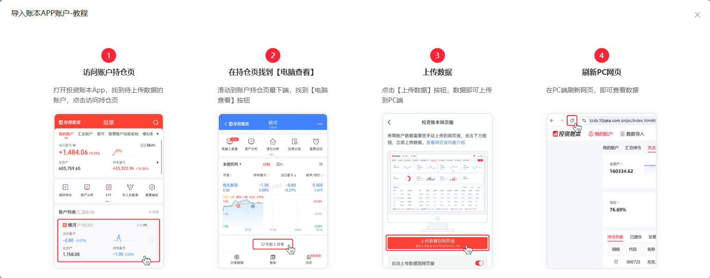

<h1 align="center">dsh-ths-holdings</h1>

<p align="center">
  <a href="https://awesome-dsh-plugin.com"></a>
  <a href="https://www.npmjs.com/package/dsh-ths-holdings"></a>
  <a href="https://github.com/PM25000/dsh-ths-holdings"></a>
  
</p>

[English](README.md) | 中文

[DeepSeek Harness](https://github.com/deepseek-ai/deepseek-harness)（DSH）桌面端与网页端上的**持仓盈亏悬浮卡片**。自动从[同花顺投资账本](https://tzzb.10jqka.com.cn)同步你的**真实持仓数据**——无需手动添加股票。实时显示**今日盈亏**、**上证指数**和当日分时走势图，遵循 A 股红涨绿跌惯例。

与自选股盯盘工具不同，这个插件读取的是你的**真实持仓**，显示**真实盈亏**——百分比和金额都支持——每 20 秒自动刷新。

## 截图


## 版本兼容性

插件 **0.3.0** 适配 DSH **0.2 系列**，已在 Desktop **0.2.0-rc.2** 验证加载与运行，无需版本兼容性豁免。DSH 0.1 系列请保留旧插件 **0.2.0**；本次适配不支持旧宿主。

**0.3.0** 新增普通聊天查询持仓、定时持仓报告和「立即更新数据」，并包含网络层稳定性修复。

## 安装

### 桌面端

1. 打开 DSH 桌面端，在左侧栏点击 **插件**。
2. 点击 **添加插件**，在包名输入框填写 `dsh-ths-holdings`。
3. 按提示确认信任该插件，点击 **安装**。
4. 安装完成后点击 **立即启用**，右下角出现悬浮卡片；如果提示需要重启，请完全退出桌面端后重新打开。

桌面端目前不支持插件自动更新。已安装旧版时，请先在插件页卸载，再安装新版。详见 [DSH 官方插件安装说明](https://github.com/deepseek-ai/deepseek-harness/blob/master/packages/client/ui-plugin-manager/README.zh.md#安装一个组合包)。

### 网页端

在终端执行：

```sh
dsh plugin --profile web add dsh-ths-holdings
```

安装完成后**重启 `dsh web`** 并刷新 DSH 页面，右下角出现悬浮卡片。

桌面端和网页端分别管理各自的插件；请按使用的端选择安装方式。

## 使用

**推荐方式（自动获取）**：

1. 打开 DSH 桌面端或网页端，点击卡片上的 **⚙**。
2. 点击 **🖥 自动获取 Cookie（推荐）**——会弹出系统浏览器窗口（Edge / Chrome，自动选择已安装者）。
3. 在弹出的窗口里完成同花顺投资账本登录（扫码 / 账号密码）。
4. 登录成功后窗口自动关闭，Cookie 自动保存，卡片立即刷新并显示你的持仓。
5. 插件自动发现你的组合——如有多个，从下拉框选一个即可。

在 ⚙ 设置展开页点击 **立即更新数据**，可使用已保存的登录状态和所选组合立即拉取盈亏与指数。查询时按钮显示“更新中…”；失败时保留上次成功数值和原更新时间。

**手动方式（如偶尔需要）**：

1. 打开 [https://tzzb.10jqka.com.cn](https://tzzb.10jqka.com.cn) 并登录。
2. **用鼠标点击浏览器右上角菜单 → 更多工具 → 开发者工具**（Edge 为 `…`，Chrome 为 `⋮`）。本页按 F12 可能无反应，请从浏览器菜单打开。
3. **保持开发者工具打开**，切换到 **网络 / Network**，然后刷新投资账本页面，让工具记录请求。
4. 在请求列表中选择发往 **`tzzb.10jqka.com.cn`** 的页面或账本接口请求，展开 **标头 / Headers → 请求标头 / Request Headers**，找到 **Cookie**，复制它的完整值。只复制 `name=value; name2=value2` 这部分，不要带 `Cookie:` 前缀，也不要复制响应中的 `Set-Cookie`。
5. 回到 DSH 桌面端或网页端，点击卡片上的 **⚙**，把 Cookie 粘贴进 **STOCK_PNL_COOKIE** → **保存**。
6. 保存后卡片会当场校验 Cookie——显示 **✓ 有效** 或 **✗ 无效**（无效会给出原因与提示）。

如果网页出现「当前页面不支持开发者工具」，可先查看 Network 中已记录的本站请求是否带有 Cookie；没有可复制的 Cookie 时，改用上面的自动获取。手动查看 Cookie 时需要保持开发者工具打开。

会话 Cookie 会过期——过期时卡片显示 **Token 已过期** 横幅，重开 ⚙ 点 **自动获取**（或重复手动步骤 1–5）即可。

> 💡 完成一笔新交易后，请在投资账本 **APP** 上重新上传数据到网页版，避免两端持仓不一致。
>
> 

## 聊天查询持仓

安装并启用插件后会自动挂载随包的 `ths-portfolio-report` Skill，普通聊天和定时任务均可使用，无需单独安装 Skill 或部署 MCP 服务。登录和账本选择沿用卡片设置，无需手动查找或填写账本 ID。

完成登录后，在 DSH 聊天中直接说：

> 查询我的同花顺投资账本持仓

助手会使用当前选择的账本。有多个账本且尚未选择时，按提示选择账本名称即可。也可以直接说“查询同花顺投资账本中‘长期投资’的持仓”。

报告默认包含资产概览、完整持仓和主要持仓分布，列出股票名称与代码、数量、成本价、现价、市值、仓位、持仓盈亏和日盈亏。报告会区分本次查询时间与账本上传时间；数据缺失时会说明，不把缺失项当作零。

## 定时报告

例如，在聊天中说：

> 每个工作日下午4点半，查询我的同花顺投资账本持仓，生成持仓和盈亏报告。按北京时间执行，固定使用当前选择的账本。

也可以结合新闻查询：

> 每个工作日上午9:00，查询同花顺投资账本的持仓，并告诉我持仓相关的重要新闻

创建后请让助手确认账本名称和下次运行时间。定时报告需要 DSH 保持运行，并启用定时任务功能（Schedule）；工作日规则不会自动排除交易所节假日。

## 特性

- **📊 实时持仓盈亏** — 每 20 秒（可配置）轮询你的真实组合
- **¥ / % 切换** — 今日盈亏可按金额、百分比或两者同时显示
- **📈 当日走势图** — 迷你折线 + 零轴虚线，红涨绿跌
- **🇨🇳 上证指数** — 与你的盈亏并列显示
- **🔄 自动发现** — `fund_key` 从组合列表自动获取；多账户可通过下拉框选择
- **🖥 自动获取 Cookie** — 一键弹出 Edge 登录窗口，登录即自动保存，无需 F12
- **✓ 保存即校验** — 粘贴或自动获取后当场验证 Cookie 是否被账本接受
- **↕ 可拖动** — 沿右侧边缘上下拖动标题栏（位置存 localStorage）
- **⚙ 就地设置** — 粘贴 Cookie、选择组合，全在卡片上完成
- **🔒 凭据安全** — Cookie 始终留在宿主进程

## FAQ / 故障排查

| 现象 | 原因与解决 |
|---|---|
| 卡片显示 `请配置 Cookie` | `STOCK_PNL_COOKIE` 为空——在 ⚙ 面板点「自动获取」或手动粘贴。 |
| 卡片显示 `Token 已过期` | 会话 Cookie 过期——重新自动获取，或按上方手动步骤复制请求标头中的 Cookie。 |
| 按 F12 没反应 | 从浏览器右上角菜单 → 更多工具 → 开发者工具打开，再按手动步骤查找 Cookie。 |
| 登录页面提示「当前页面不支持开发者工具」 | 自动获取不需要打开开发者工具。手动方式可先查看 Network 已记录的本站请求；没有可用 Cookie 时改用自动获取。 |
| 自动获取弹出窗口后没有反应 | 在弹出窗口完成登录（扫码 / 账号），登录后窗口会自动关闭并保存。 |
| 保存后徽标显示 `✗ 无效` | 粘贴的 Cookie 已失效或不是投资账本会话——重新登录获取后再试；面板会给出具体原因。 |
| 下拉框没有组合 | 组合列表需要有效的 Cookie——先保存有效 Cookie，再点 ↻ 刷新。 |
| 有多个组合 | 从下拉框选一个——选择会保存为 `STOCK_PNL_FUND_KEY`。 |
| 粘贴的 Cookie 带换行 | 插件保存时会去掉空白，换行粘贴也没问题。 |
| 提示“稍后重试”或“数据暂时无法获取” | 稍后再试。卡片可能保留上次成功值，请留意显示的更新时间。 |
| 助手无法查询持仓 | 确认插件已启用且已完成登录，完全重启 DSH 后再试。 |
| 报告查询失败，但卡片有数值 | 卡片可能显示旧快照；报告按本次查询失败处理，不会使用旧值替代。 |

## 已知限制

- **自动获取使用系统浏览器** — 无需安装 Playwright，自动选择已安装的 Edge / Chrome；机器上两者都没有时需手动粘贴。浏览器必须运行在可显示窗口的桌面会话中。
- 持仓报告目前支持人民币沪深股票及 ETF 普通账本，暂不支持融资融券、空头、B 股及其他市场。
- 登录信息只填写在插件设置中，不要放进聊天或定时任务提示。

## License

[MIT](LICENSE)
